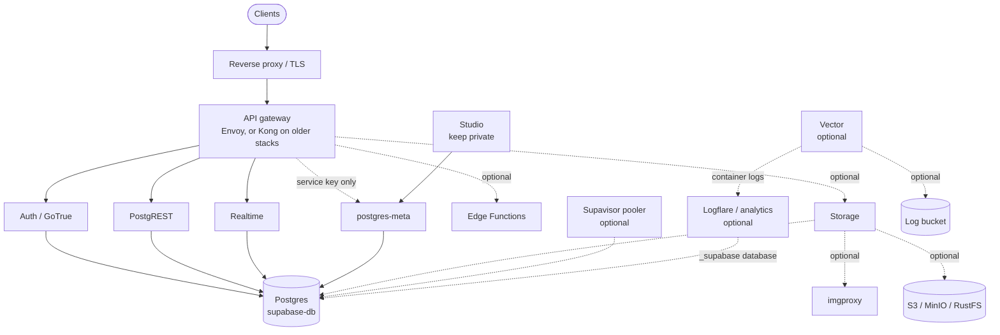

# Self-hosted Supabase in production

**The day-2 handbook for self-hosted Supabase: backups and restore drills, point-in-time recovery, safe upgrades of long-running stacks, hardening, trimming, disk and WAL growth, monitoring, and Coolify. The parts the official docs leave to you.**

[Quick wins](#quick-wins-in-10-minutes) · [Backups](docs/02-backups-and-restore.md) · [PITR](docs/03-point-in-time-recovery.md) · [Upgrades](docs/04-upgrades.md) · [Hardening](docs/01-production-checklist.md) · [Disk and WAL](docs/06-disk-and-wal-growth.md) · [Monitoring](docs/07-monitoring-and-health-checks.md) · [Coolify](docs/08-coolify.md) · [Studio](docs/09-studio-private-by-default.md) · [Gotchas](docs/gotchas.md) · [FAQ](docs/faq.md) · [All contents](#contents)

Maintained by Seunghun Lee, who runs [transcribe.so](https://transcribe.so) (speech to text) on self-hosted Supabase in production ([LinkedIn](https://www.linkedin.com/in/shsunmoon/) · [X](https://x.com/shsunmoon)). Need a production self-hosted setup done for you? See [Work with me](#work-with-me).

| Tested component | Version | Date |
|---|---|---|
| Postgres (`supabase/postgres`) | `17.6.1.163` (upgraded from `15.14.1.163`) | 2026-10-19 |
| Gateway | Envoy `v1.39.1` (replaced Kong `2.8.1`) | 2026-10-19 |
| PostgREST | `v14.18` | 2026-10-19 |
| Realtime | `v2.143.3` | 2026-10-19 |
| GoTrue | `v2.197.0` | 2026-10-19 |
| postgres-meta | `v0.100.0` | 2026-10-19 |
| Studio | `2026.10.12-sha-3699278` | 2026-10-19 |
| Vector | `0.45.0-alpine` | 2026-10-19 |
| Platform | Docker Compose managed by Coolify 4.4.6 | 2026-10-19 |

Tested on a production stack and its rehearsal clone; digests in [versions.md](versions.md). Every chapter says what we verified and what comes from upstream.

If this saves you an incident, a star helps other self-hosters find it.

## Start here

- **Stock Compose install from the official guide:** [Production checklist](docs/01-production-checklist.md).
- **On Coolify:** [Supabase on Coolify](docs/08-coolify.md).
- **A stack that is years old:** [Upgrades](docs/04-upgrades.md).
- **"My backup just failed":** [Backups and restore](docs/02-backups-and-restore.md).

## Quick wins in 10 minutes

Each one is read-only and ends with a check. Replace `<service-uuid>` with your stack's id (on Coolify, the service UUID; on plain Compose, your project name) and copy `scripts/` into the db container first: `docker cp scripts/. supabase-db-<service-uuid>:/tmp/checks/`.

1. **Secrets have real lengths.**
   `bash scripts/check-secret-lengths.sh <stack dir>/.env <stack dir>/docker-compose.yml`
   Check: exit 0. A FAIL on anything feeding `SECRET_KEY_BASE` means Realtime runs without a session key.
2. **Admin ports are closed from outside.** From another network:
   `for p in 5432 6543 8000 4000 3000; do nc -z -w 3 <public-ip> $p && echo "OPEN $p"; done`
   Check: nothing printed.
3. **The Realtime tenant API is not public.**
   `curl -s -o /dev/null -w '%{http_code}\n' https://<api-host>/realtime/v1/api/tenants -H "apikey: <anon key>"`
   Check: 403 (or 401), never 200.
4. **No SECURITY DEFINER function or RLS-less table is open to anon.**
   `docker exec supabase-db-<service-uuid> psql -U supabase_admin -d postgres -X -f /tmp/checks/hardening-check.sql`
   Check: sections 1 and 2 print 0 rows; section 3 prints no tables (views are always listed, because a plain view runs as its owner and bypasses RLS: check each view's owner and `security_invoker`).
5. **No replication slot is quietly filling the disk.**
   `docker exec supabase-db-<service-uuid> psql -U supabase_admin -d postgres -c "select slot_name, active, pg_size_pretty(pg_wal_lsn_diff(pg_current_wal_lsn(), restart_lsn)) from pg_replication_slots; show max_slot_wal_keep_size;"`
   Check: every inactive slot is one you can name, and the cap is not `-1`.
6. **Your newest backup is not empty and is readable.**
   `ls -l <newest backup>; pg_restore --list <newest backup> | head -3`
   Check: a non-zero size and a table of contents, not an error.
7. **The `pgsodium` key is backed up.**
   `docker run --rm -v <service-uuid>_supabase-db-config:/v:ro alpine sha256sum /v/pgsodium_root.key` (volume name as Coolify creates it; on plain Compose use your bind path), then `sha256sum` your backup copy.
   Check: the two hashes match.
8. **You have a baseline.**
   `docker exec supabase-db-<service-uuid> psql -U supabase_admin -d postgres -X -f /tmp/checks/preflight.sql > preflight-$(date +%F).out`
   Check: the file lists your databases, extensions, event triggers and cron jobs. Keep it; [verify.sql](scripts/verify.sql) diffs against it after any change.

## Why this exists

Supabase's [self-hosting overview](https://supabase.com/docs/guides/self-hosting) is honest about it: managed backups and PITR, advanced metrics and the Management API are not available self-hosted, and backups, disaster recovery, monitoring and maintenance are the operator's job. The official guides now cover installing, [updating](https://supabase.com/docs/guides/self-hosting/updating) a stock compose, the [Postgres 17 upgrade](https://supabase.com/docs/guides/self-hosting/postgres-upgrade-17) and the [Envoy gateway](https://supabase.com/docs/guides/self-hosting/self-hosted-envoy). This handbook links to those and covers the rest, from running a real production stack and upgrading it from years-old versions in one maintenance window ([case study](docs/case-study-2026-10-19.md)).

| | Supabase Cloud | Stock self-hosted Compose | With this handbook |
|---|---|---|---|
| Backups | Daily backups on paid plans ([docs](https://supabase.com/docs/guides/platform/backups)) | Not provided; your job ([overview](https://supabase.com/docs/guides/self-hosting)) | [Full backup set (globals, per-database dumps, the key volume), restore traps, a monthly drill](docs/02-backups-and-restore.md) |
| Point-in-time recovery | Available ([docs](https://supabase.com/docs/guides/platform/backups)) | Not available ([overview](https://supabase.com/docs/guides/self-hosting)) | [A WAL-streaming design with safety rules (rehearsed; see the chapter for status)](docs/03-point-in-time-recovery.md) |
| Upgrades | Dashboard upgrades ([docs](https://supabase.com/docs/guides/platform/upgrading)) | `update.sh` and a PG 17 script for stock installs ([updating](https://supabase.com/docs/guides/self-hosting/updating)) | [Long-running and platform-managed installs, ordering, hop sequences, rollback, a tested matrix](docs/04-upgrades.md) |
| Hardening | Security Advisor lints ([docs](https://supabase.com/docs/guides/observability/advisors)); RLS still yours | Scattered across guides | [One checklist with a check per item, plus a read-only SQL check](docs/01-production-checklist.md) |
| Disk / WAL growth | Managed | Open issues ([supabase#43643](https://github.com/supabase/supabase/issues/43643)) | [What grows, how to check it, what to alert on](docs/06-disk-and-wal-growth.md) |
| Monitoring | Dashboard and metrics ([docs](https://supabase.com/docs/guides/observability/metrics)) | Logs; advanced metrics not available ([overview](https://supabase.com/docs/guides/self-hosting)) | [Health endpoints per service, internal-path probes, an alert list](docs/07-monitoring-and-health-checks.md) |
| Coolify | n/a | Not covered | [A chapter of Coolify-specific behaviour](docs/08-coolify.md) |

## The stack, and what you can remove

Dotted lines are services many production apps can remove. We removed Storage, imgproxy, MinIO, Logflare and Supavisor; see [Trimming the stack](docs/05-trimming-the-stack.md) for how to check that nothing uses them first.

## Contents

1. [Production checklist and hardening](docs/01-production-checklist.md): exposure, keys, default grants, SECURITY DEFINER, superuser
2. [Backups and restore](docs/02-backups-and-restore.md): the full backup set, what breaks restores, the drill
3. [Point-in-time recovery](docs/03-point-in-time-recovery.md): WAL streaming design, `restore_command` exit codes, what to alert on
4. [Upgrades](docs/04-upgrades.md): what the official guides cover, what they leave out, ordering
   1. [Inventory and preflight](docs/upgrades/01-inventory-and-preflight.md)
   2. [Rehearse on a clone](docs/upgrades/02-rehearse-on-a-clone.md)
   3. [Kong to Envoy](docs/upgrades/03-kong-to-envoy.md)
   4. [Service hops: PostgREST, Realtime, postgres-meta, Studio, Vector](docs/upgrades/04-service-hops.md)
   5. [Postgres 15 to 17 with pg_upgrade](docs/upgrades/05-postgres-15-to-17.md)
   6. [The window, verification and rollback](docs/upgrades/06-the-window.md)
5. [Trimming the stack](docs/05-trimming-the-stack.md): removing Storage, Logflare, Supavisor safely
6. [Disk and WAL growth](docs/06-disk-and-wal-growth.md): replication slots, `_supabase`, images and volumes
7. [Monitoring and health checks](docs/07-monitoring-and-health-checks.md): per-service checks, internal vs public probes, alerts
8. [Supabase on Coolify](docs/08-coolify.md): every Coolify-specific behaviour we hit
9. [Studio: private by default](docs/09-studio-private-by-default.md): what basic auth does and does not protect, three ways to keep Studio off the internet, a verify checklist
- [Gotchas](docs/gotchas.md): 32 things that broke, or nearly did, one paragraph each
- [Case study: one maintenance window](docs/case-study-2026-10-19.md)
- [FAQ](docs/faq.md)
- [Tips for the next upgrade](docs/tips.md)
- [Tested versions](versions.md) · [Changelog](CHANGELOG.md)

## Scripts

Read each script before running it. None uploads anything.

| Script | What it does | Changes anything? |
|---|---|---|
| [`scripts/preflight.sql`](scripts/preflight.sql) | Inventory: databases and sizes, extensions, event triggers and owners, cron jobs, slots, roles, collation, ACL fingerprints | No |
| [`scripts/verify.sql`](scripts/verify.sql) | The same inventory plus PASS/FAIL checks after an upgrade | No |
| [`scripts/hardening-check.sql`](scripts/hardening-check.sql) | SECURITY DEFINER functions open to anon, unsafe `search_path`, RLS-less exposed tables, default privileges, superuser roles | No |
| [`scripts/check-secret-lengths.sh`](scripts/check-secret-lengths.sh) | Names and lengths (never values) of every variable in a compose `.env`; fails on empty secrets and short `SECRET_KEY_BASE` inputs | No |
| [`scripts/safe-recreate.sh`](scripts/safe-recreate.sh) | Recreates one container of a Coolify stack, restoring its networks and aliases, checking bind files and probing a URL | Only with `--apply` |
| [`scripts/pg17-upgrade.sh`](scripts/pg17-upgrade.sh) | In-place Postgres 15 to 17 for Coolify's named volumes, with `prepare` gates and rollback | Yes: the database volumes. Rehearse first |

Requirements: bash 4+, Docker with Compose v2.17+ (`--dry-run`), `psql` 14+ for the optional row counts.

Also available as standalone gists (snapshots; this repo is the maintained version): [Postgres 15 to 17 on Coolify with rollback](https://gist.github.com/shsunmoonlee/05aa8c51df7b831cc9cccfe0e684978d) · [Recreate one container without losing the coolify network](https://gist.github.com/shsunmoonlee/5e3c04b88a5fffc2ad34c4ae29084322) · [Things that broke](https://gist.github.com/shsunmoonlee/f05211715b31aba5ca37ad9aee336f5a) · [Preflight, verify and hardening SQL](https://gist.github.com/shsunmoonlee/56b62d54347f6f550f99b88ce229779f).

## What this is not

- Not an official Supabase or Coolify project, and not an installer. For installing, use the [official Docker guide](https://supabase.com/docs/guides/self-hosting/docker); for Kubernetes, [supabase-kubernetes](https://github.com/supabase-community/supabase-kubernetes); for observability tooling, [supabase-observability](https://github.com/supabase-community/supabase-observability).
- Not tested beyond [versions.md](versions.md). Storage, Edge Functions, the pooler under load and multi-node setups are not covered by our tests.
- Provided as is, without warranty. Rehearse on a clone.

## Contributing

Reports from other stacks are the most useful contribution: what you ran, from which version to which, and what broke. See [CONTRIBUTING.md](CONTRIBUTING.md). Last tested: 2026-10-19 (see the stamp above); every new test adds a dated row to [versions.md](versions.md) and an entry to the [changelog](CHANGELOG.md).

## Credits

- Upstream Supabase (`supabase/supabase` `docker/`, `supabase/postgres` upgrade scripts): the upgrade method and the Envoy configuration this work starts from.
- [coollabsio/coolify#12004](https://github.com/coollabsio/coolify/pull/12004) and [Vadko's gists](https://gist.github.com/Vadko) on migrating an existing Coolify service and on Studio access: the reference we cross-checked our runbook against.

## Work with me

I offer production self-hosted SaaS setup as a service.

- LinkedIn: https://www.linkedin.com/in/shsunmoon/
- X: https://x.com/shsunmoon

## License

Apache-2.0. See [LICENSE](LICENSE).
