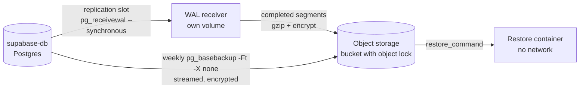

# 3. Point-in-time recovery (design)

> **Basis.** This is the design we built for our own stack. It was **rehearsed end to end in Docker** on 2026-10-17 (`supabase/postgres:15.14.1.163`) and 2026-10-20 (`supabase/postgres:17.6.1.163`): stream WAL from a scratch primary, ship it to an S3-compatible stand-in, take a base backup, restore to a named restore point and to the end of the archive, verify the data and Vault decryption. **Production rollout is pending** at the time of writing. Our scripts are not published yet; this chapter describes the design and the safety rules so you can apply them with any tool.

Self-hosted Supabase has no PITR ([overview](https://supabase.com/docs/guides/self-hosting)). If a nightly dump's data loss is too much for you, you need WAL archiving. Mature tools exist and are worth a look first: [pgBackRest](https://pgbackrest.org/) and [WAL-G](https://github.com/wal-g/wal-g), and the [supabase-selfhost-ops](https://github.com/ankaboot-source/supabase-selfhost-ops) project wires pgBackRest into a Supabase stack. We chose plain `pg_receivewal` + `pg_basebackup` + a small shipper so that nothing has to be installed inside the Supabase db image and the database host only needs a replication connection.

## Architecture

- **Receiver.** `pg_receivewal --synchronous` on a physical replication slot, from a separate machine or container, into its own volume. `--synchronous` flushes before reporting, so the slot only releases WAL that is safely on the receiver's disk.
- **Shipper.** Every few seconds: compress and encrypt each completed segment (and timeline `.history` file), upload it, and delete the local copy only after the upload is confirmed. With a bucket that refuses overwrites, an upload refused because the object exists counts as success only when the stored bytes are identical.
- **Bounded data loss on a quiet database.** A quiet database fills a 16 MB segment slowly. When nothing has shipped for a few minutes and the in-progress `.partial` changed, upload a timestamped copy of it. That bounds what is lost if only the bucket survives, without `archive_timeout`.
- **Base backups.** Weekly `pg_basebackup -Ft -X none`, streamed straight to storage. Write a small plaintext marker (start LSN, end LSN, sizes) **only after** the segment holding the end LSN is listed in storage. A restore ignores any base without the marker.
- **Retention.** Keep WAL longer than base backups (for example bases 21 days, WAL 22 days), so the oldest base you keep always has its WAL. If you use object lock, its retention must be shorter than the lifecycle deletion.

## Safety rules (each one learned in rehearsal or from Postgres semantics)

1. **Cap what a slot can hold.** Set `max_slot_wal_keep_size` (the 17 image's default is 512 MB; size it from your WAL rate). Without a cap, a dead receiver fills the database disk. With a cap, a dead receiver for too long loses the slot (`wal_status = lost`): the chain is broken, the database is fine. Alert on the headroom (`safe_wal_size`), not only on "slot inactive".
2. **Never set `synchronous_standby_names` for the receiver.** With it as the only standby, commits block when it is down.
3. **A dedicated replication role.** `REPLICATION`, `NOLOGIN` until the password is set, a connection limit, and `pg_hba.conf` lines that allow it **only** `replication` from your receiver's network, plus `reject` lines for every ordinary database (an image's broad `host all all` rule would otherwise let it log in).
4. **`restore_command` exit codes are the safety contract.**
   - `0`: restored.
   - `1`: **only** when the file is confirmed absent (a local directory without it, or a listing that succeeded and does not name it). Postgres reads exit 1 as "this file does not exist", which at the end of the archive **ends recovery, and with no target, promotes**.
   - Any storage error, timeout, unreadable directory, corrupt or short file: exit **above 125** (we use 200). Postgres treats that as fatal: recovery aborts and the server stops instead of promoting on a half-read archive. A storage outage must never return 1. Rehearsed: an object-store outage during restore aborted recovery with exit 200 and nothing was promoted.
5. **Write atomically and verify.** Decompress into `<path>.tmp`, check that a segment is exactly 16 MiB (and that decompression succeeded), then `mv` into place.
6. **Bound every storage call.** A refused connection fails fast; a black-holed endpoint does not. In rehearsal one bare download call against a black hole took about 2.5 minutes, and five default retries about 25 minutes. Put a hard wall clock on every call (`timeout`), count a timeout as a failed try (never as "absent"), and keep the total bounded.
7. **Replay a `.partial` only directly after an unbroken chain.** A partial after a hole would replay WAL past missing data.
8. **The boundary-LSN trap.** Right after `pg_switch_wal()` with no new WAL, `pg_walfile_name(pg_current_wal_lsn())` names the **previous** segment. A check built on it will think the switch did nothing.
9. **Client major = server major.** `pg_receivewal` and `pg_basebackup` must match the server's major version. After a 15 to 17 upgrade, switch the client images and take a new base right away: WAL and bases from 15 do not restore onto 17.
10. **A lost or recreated slot needs an empty receiver directory.** `pg_receivewal` resumes from the newest file in its directory and asks the slot only when the directory is empty. Reset procedure: stop the receiver, ship what is there (including the `.partial`), empty the directory, recreate the slot, start, take a base backup. Until that base exists, the gap is real.
11. **Keep the keys apart from the backups.** The encryption key for the backups and the `pgsodium` root key live outside the database host. Losing the backup encryption key loses every backup.

## Restoring

- **A table-level mistake (bad migration, bad delete): never rewind production.** Restore to a side container to just before the bad statement (`recovery_target_time`, exclusive, or a named restore point), `pg_dump` the affected tables, review, and merge by hand.
- **Host loss or a full rewind:** stop writers, move the old data volume aside (do not delete it), restore base + WAL into a fresh volume, then:
  - with **no target**, recovery replays to the end of the archive and **promotes itself**;
  - before starting the rest of Supabase, remove the recovery settings (`ALTER SYSTEM RESET restore_command;` and any `recovery_target_*`), reload;
  - the database is now on a new timeline: Realtime recreates its slots, your receiver needs a reset, take a base backup immediately.
- **Drill monthly** on a throwaway machine with the restore container on `--network none`: create a restore point on production (`select pg_create_restore_point('drill-<date>')`), restore to it, run verification SQL (row counts, event triggers, Vault decrypt), record the time. Our Docker rehearsals restored in seconds; production restores take as long as downloading the base, so measure yours.

## What to alert on

| Signal | Why |
|---|---|
| Slot missing, `wal_status` `lost`/`unreserved`, or `safe_wal_size` under half the cap | The receiver is down or behind; act before the slot is lost |
| Receiver not connected (`pg_stat_replication`), or nothing shipped for longer than the partial interval | The stream stopped |
| A missing segment after the newest complete base | A restore cannot cross the hole: take a base now |
| No complete base in 8 days, or a base under half the previous size | The base job is failing |
| No passing drill in 35 days | You no longer know that restores work |
